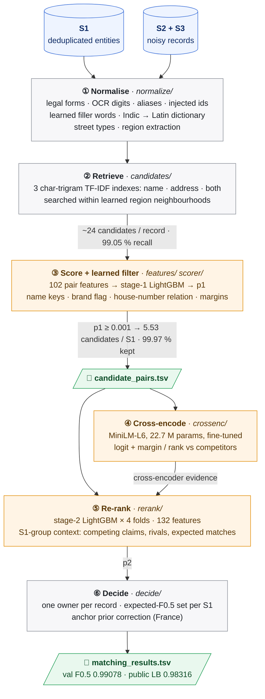

# ML Challenge 2026: Business Entity Resolution Solution

**Team Members:** Sreenitya Thatikunta, Rudraksha Dev Sharma
**Submission Date:** 2026-09-28

| Public leaderboard | Validation macro F0.5 | Unseen-region validation | Candidates per S1 (test) | Candidate recall (val) | Pretrained model |
|:---:|:---:|:---:|:---:|:---:|:---:|
| **0.98316** | **0.99078** | **0.98988** | **5.53** | **99.02 %** | MiniLM, 22.7 M params, Apache-2.0 |

---

## 1. Executive Summary

Our solution is a cascade that never has to compare every record with every entity. In order, it does six things:

1. We clean up names and addresses, targeting the specific kinds of noise we found in the data.
2. We pull candidates with character-trigram TF-IDF, searching only near the record's region.
3. A LightGBM pair scorer throws out almost all of those candidates. What's left is 5.53 per S1, and 99.97 % of the true pairs we retrieved are still there.
4. A small fine-tuned transformer (a MiniLM cross-encoder) reads each remaining pair side by side.
5. A second LightGBM re-scores every candidate knowing who else is competing for the same entity, and how strongly.
6. For each entity, we keep the set of records that gives the best expected F0.5.

A few ideas made the biggest difference:

- **Our first classifier is also our blocker.** Stage 1 is the first matcher and the last filter at once. It takes about 24 TF-IDF candidates per record down to roughly one, and loses almost nothing on the way.
- **Looking at the competition.** Stage 2 can see every record that claims the same entity, which a model scoring one pair at a time can't. This was our largest single gain.
- **Training on data that looks like the test set.** The re-ranker learns from whole held-out states with every entity's records present. Features that depend on how crowded the data is get rescaled per country and split.
- **Using a weak model as a hint.** On its own, the transformer is clearly worse (AUC 0.975 against 0.999). But how much it prefers one candidate over the others turned out to be a very useful signal, worth +0.0016 on validation and +0.0008 on the leaderboard.
- **Handling France without labels.** France has a kind of name change the US and India don't. We estimate how often it's a real copy by looking at house numbers in the unlabelled test data.

---

## 2. Methodology

### 2.1 Problem Analysis

We spent a good amount of time in the raw training and test files before building anything. These were the findings that shaped the design:

| Finding | Evidence | What we did about it |
|---|---|---|
| Each record has at most one owner, and matches never cross countries | All 7.6 M matched ids are unique, and no true pair crosses a border | Assign each S2/S3 record to at most one S1, and only search within its country |
| Names are ambiguous; addresses usually settle it | Half of all S1 share their core name with another S1 ("Meridian" appears 572 times), but only 6.8 % share an exact address | Lean heavily on address and house-number features |
| The data contains planted lookalikes | Unmatched copies of an S1 with one letter changed, a swapped credential (MD → JD), or a **house number a few units off** (5835 → 5838), often with a PO box added | Very fine-grained number features, plus context about competing records |
| The test set isn't shaped like training | France only appears in test. Test also has ~5.7 S2/S3 records per S1 against 4.7 in training (≈ 40 % unmatched vs 26 %) | Validate on held-out regions and rescale features per split |
| France has its own kind of name noise | At the same address, the *generic* word gets swapped (`Ski College SARL` → `Ski Comite SARL`). That's 6.6 % of French same-street pairs, against 0.1 % in the US and 1.5 % in India | A prior correction that doesn't need labels (section 4.5) |

On the name side, true pairs showed:
- legal-form swaps and typos in legal words (`PRlVATE`, `Priavte`);
- OCR-style digit swaps (`Hea1th 5ervices`) and plain letter typos (`Mitllls`);
- words in a different order, or doubled;
- aliases (`aka`, `dba`, `formerly`, `nee`) and domains (`bwford.com`);
- ids and phone numbers pasted into the name (`(ID: 63317)`, `- 9334025793`), in about 1 % of records;
- **filler words** that depend on the country (US `Riverside/Holdings`, India `Smt/Shri/Infratech`, France `Participations/Holding`);
- names written in Indian scripts (23 % of Indian S2 names);
- **made-up brand names replacing the whole name** (`Grand Physical Therapy` → `Jaxdrexquo`), in 1.6 % of true pairs.

Addresses were messy in their own ways:
- abbreviations (Rd/Road, R./Rue);
- the same state written as a name, a code, an Indian-script name or a French département;
- parts reordered or dropped, and zero padding;
- house numbers cut short (7622 → 762) or with a digit typo (394 → 894);
- in India, a **fake house number stuck on the front** (`H.NO 937 33, …`);
- 4 % of S2/S3 addresses were simply empty.

### 2.2 Solution Strategy

**Approach Type:** a hybrid. Blocking and a learned filter, then a transformer cross-encoder, a group-aware gradient-boosted re-ranker, and an expected-F0.5 decision at the end.

**Core Innovation:** there are three pieces that make it work.
- The stage-1 classifier doubles as the final blocking filter, so the candidate set stays tiny without costing us recall.
- The stage-2 re-ranker is cross-fitted on *complete* S1 groups, so it can weigh competing claims on the same entity.
- The transformer isn't asked to decide anything. It only tells the re-ranker how much it prefers each candidate over the alternatives.

Here's how the stages fit together:



**How we validated.** We never split by random records. We split by whole US and Indian states, because lookalikes sit at nearby addresses, and splitting by state keeps them on the same side as the entities they copy.

We also score every validation record. So our validation F0.5 already includes blocking losses, entities with no matches and every stage of the pipeline, the same as the leaderboard does.

| Data part | Share of S1 | What it's used for |
|---|---|---|
| Train regions | ~50 % | Stage 1 trains on 14 % of the featurised records here. The cross-encoder trains on the rest, where stage 1's scores are out-of-sample. |
| Held-out train regions ("hold") | ~40 % | Training the stage-2 re-ranker. Stage 1 never sees these. |
| Validation regions | ~10 % | Also stage-2 training (cross-fitted, so every pair still gets an honest out-of-fold score), and all our metrics |

---

## 3. Candidate Generation (Blocking)

Everything starts with normalisation (`src/ber/normalize/`), because retrieval is only as good as the text it searches.

- **Names.**
  - We strip Latin accents, turn `&`, `+` and `et` into `and`, and collapse `L.L.C.` to `llc`.
  - We split out aliases, unwrap domains, and drop ids and phone numbers that were pasted in.
  - OCR-style digits inside words go back to letters.
  - Legal forms get a canonical spelling and move out of the core name. We tolerate one typo in long legal words.
  - Stopwords, honorifics and doubled words go.
- **Indian-script names.**
  - We learn a dictionary of 1,164 words from training pairs. For anything else, we romanise by rule and snap the result to the closest S1 word by consonant skeleton.
  - On held-out tokens this gets 95.8 % exactly right. Rules alone manage 23 %.
- **Addresses.**
  - We drop placeholders and zero padding, and spell street types the same way within each country.
  - States, state codes, Indian-script states and French régions and départements go into a separate `region` field.
  - We keep the raw digit strings, because the number features need them.

Blocking then happens in three layers:
- **TF-IDF indexes.** Each country gets three character-trigram indexes: one on the core name, one on the address words (in any order), and one on both. A record takes the union of the top 10 from each. If its address is empty, it takes the top 30 by name instead.
- **Region blocking.** A record only searches the S1 in its region's *neighbourhood*, which we learn from training pairs. For example, Andhra Pradesh and Telangana are neighbours, since addresses often mix them up. Records with no recognisable region search the whole country.
- **The learned filter.** The stage-1 pair scorer (section 4) keeps only pairs with p1 ≥ 0.001. This is the last cut before the final model, and whatever survives is exactly what's in `candidate_pairs.tsv`.

**How many candidate pairs that leaves on test:**

| Step | Pairs | Per S2/S3 record | Per S1 |
|---|---:|---:|---:|
| Every S1 in the same country | | ~10⁶ | |
| TF-IDF top-k union | 243,753,102 | 24.4 | |
| After the stage-1 filter = **`candidate_pairs.tsv`** | **9,582,745** | **0.96** | **5.53** |

An S1 has 3.4 true matches on average. So 5.53 candidates per S1 is not far from the smallest set that could possibly work.

**Making sure we didn't lose true matches.** We tracked recall on the validation side after every step:
- TF-IDF retrieval finds 99.05 % of true pairs (99.3 % in the US, 98.2–99.2 % in India).
- The stage-1 filter keeps 99.97 % of those, so 99.02 % overall.
- We picked the filter level from a trade-off table the pipeline writes out:

  | p1 threshold | Pairs per record | Retrieved true pairs kept |
  |---|---:|---:|
  | **0.001 (what we use)** | 1.07 | 99.97 % |
  | 0.003 | 0.97 | 99.92 % |
  | 0.01 | 0.88 | 99.75 % |

- Most of what we still miss are records with no address whose name is shared by dozens of S1.

On scale, the pipeline only ever holds one country and one region block in memory. Top-k search can optionally run on a GPU through CuPy, and with it, retrieval on the test set takes 78 minutes.

---

## 4. Matching Model (Architecture and Feature Engineering)

### 4.1 Stage 1: pair scorer and learned filter (102 features)

| Group | Features |
|---|---|
| **Name** | exact core/compact equality; Levenshtein split into substitutions, insertions/deletions and transpositions; ratio, token-set/sort and partial ratio; Jaro-Winkler; alias parts; initials (`VPC` ↔ `Vision Precision Clinic`); first and last token; whether legal forms agree or conflict; domain, alias and Indic flags; share of out-of-vocabulary tokens; how many S1 share the exact core name |
| **Filler-free name key** | the name with filler words removed. We learn fillers without labels, as tokens at least 2× more common in S2/S3 names than in S1 names. On this key: equality, Levenshtein, token-set ratio, **IDF-weighted recall and precision**, and the largest IDF of an unmatched token on each side |
| **Made-up brand** | a flag for names built from ~45 learned syllables. It catches 96 % of brand replacements and fires on only 0.03 % of S1 names |
| **Address** | equality; token-set, ratio and partial ratio; whether the regions agree, conflict or are missing; the **house-number relation** (equal / padded / truncated / shifted / different) and log difference; overlap of number sets; **whether the S1 house number appears anywhere among the record's numbers**; digit edit distance; **the position of the first digit that differs**; PO box and PMB flags; IDF-weighted overlap of address words |
| **Retrieval context** | the three TF-IDF cosines and ranks. For 8 key similarities we also add the margin over the record's best *other* candidate, the gap to its best, and the rank. Then candidate counts per record and per S1 |

The model itself is LightGBM with 127 leaves and a learning rate of 0.05. It trains on 3.6 M pairs, stops early at iteration 330, and reaches a validation AUC of 0.99994.

### 4.2 Cross-encoder: the transformer's second opinion (`src/ber/crossenc/`)

- **What it is.** We use `cross-encoder/ms-marco-MiniLM-L-6-v2`: 6 layers, 22.7 M parameters, Apache-2.0. Each record becomes one short line, `name core + legal form ; address + region`, and a pair is capped at 64 word pieces.
- **How we fine-tune it.** Binary cross-entropy with AdamW for 2 epochs, batch size 256, learning rate 5e-5 with a 5 % warm-up, in fp16. That takes about 20 minutes on a single GPU.
- **What it trains on.** 982,265 pairs (68 % true) from stage 1's own regions, taken from the records stage 1 did *not* train on. It never sees a validation or held-out label, so every score it gives on validation, held-out and test pairs is out-of-sample.
- **Why it's weak on its own.** Its AUC is 0.975, against 0.999 for the cascade.
  - It memorises street and city names from the training regions, and those don't carry over to new regions.
  - It sees house numbers as word pieces (`848` vs `843`), and that's exactly where the lookalikes differ.
- **Why it still helps.** We don't give stage 2 just its raw score. We also give how far that score is ahead of the record's other candidates and the S1's other records, and where it ranks (`ce`, `ce_q_margin`, `ce_q_rank`, `ce_s_margin`, `ce_s_rank`). Those features end up 4th, 5th and 9th of 132 by gain.

### 4.3 Stage 2: the group-aware re-ranker (132 features)

Stage 2 sees everything stage 1 saw, and then some:
- p1 and its logit, all 102 stage-1 features, and the 5 cross-encoder features;
- **the record's context:** where this pair ranks among the record's candidates, and the best, sum and count of its other p1 scores;
- **the S1's context:**
  - where this record ranks among everyone listing the same S1;
  - the best, sum and count of competing p1 scores, overall and within the record's own source;
  - **claims**, meaning records whose top pick is this S1, how many of them we'd expect to be real, and the strongest competing claim.

> This S1 context is what tells a true copy apart from the lookalike sitting next to it. Both score high against the same S1, but only one of them should win.

**Making training look like test.** Most of our late gains came from getting this right:
- **Train on many regions.**
  - The re-ranker picks up region-specific habits, and every test region is new to it.
  - So we hold out 40 % of each country's states just for stage 2 (stage 1 never trains on them), and cross-fit on validation and held-out states together.
- **Only train on complete groups.**
  - Validation and held-out records also list S1 from other training regions. Those S1's own records are never loaded, so their groups look empty.
  - A model trained on them learns "empty group → reject". That never happens at test time, where every group is complete.
  - So we leave those pairs out of training (we still score them). Held-out records also follow their owner's state, like in the validation split.
- **Rescale for density.**
  - Test US has half the S1 of training US and 23 % more S2/S3 records per S1. A classifier can tell validation pairs from test pairs with an AUC of 0.99.
  - So we divide 16 count-like features by their mean and 4 IDF-like features by their 99th percentile, within each country and split. The scale comes from complete groups only.
  - This alone was worth +0.003 on the leaderboard.

The re-ranker is LightGBM with 63 leaves, **cross-fitted over 4 folds** grouped by each record's top S1. Every validation pair gets an out-of-fold score, which keeps validation honest. Test pairs get the average of the 4 fold models.

### 4.4 The models at a glance

| Component | Model | Size | Trained on |
|---|---|---|---|
| Stage 1 | LightGBM binary (127 leaves, lr 0.05) | 330 trees | 3.6 M pairs from the train regions |
| Cross-encoder | MiniLM-L6 (Apache-2.0) | 22.7 M params | 982 k out-of-sample pairs from the train regions |
| Stage 2 | LightGBM binary × 4 folds (63 leaves, lr 0.05) | up to 2,000 trees each | the complete-group pairs among 1.11 M validation + 4.28 M hold pairs |

The cross-encoder is our only pretrained model, and at 22.7 M parameters it's far under the 8 B limit.

### 4.5 Decision and threshold selection

- **One owner per record.** Each record goes to its highest-scoring S1. Exact duplicate records share one owner.
- **Expected F0.5 per S1.**
  - We sort an S1's records by p2 and keep the prefix that maximises expected F0.5 (≈ 1.25·Σp / (0.25·Σp_all + k)).
  - We compare that against predicting nothing, which scores P(no match) = Π(1 − p).
  - Pairs below `min_p` are dropped first. We picked `min_p` = 0.02 on validation, though the curve is almost flat (0.99075–0.99078 anywhere from 0.02 to 0.5).

**A label-free correction for France (`decide/anchor.py`).** A model trained on the US and India has no way of knowing how often a new kind of name change is a real copy. So we estimate it from the unlabelled test data, using house numbers as an *anchor*:
- **The idea.** Whether a pair is a real copy or not, its house-number pattern (equal, shifted, missing, and so on) doesn't depend on how the name was changed.
  - On validation, real copies look the same whether the name is exact, has a typo, or had a generic word swapped.
  - Lookalikes, on the other hand, are mostly *shifted*.
- **The estimate.** That makes each name-change kind's house-number histogram a mix of the "real copy" and "lookalike" profiles. A least-squares fit gives us its share of real copies, π.
- **When it kicks in.** Only when a kind has at least 2,000 pairs and its de-biased odds ratio, odds(π) / odds(mean p2), is off by more than 2×. We cap the ratio at 6.
- **How we tested it.**
  - Across eight simulated label shifts where the model stays calibrated, it never fired.
  - When we deliberately gave one kind the wrong prior, it won back 96–99 % of the lost F0.5.
- **What happened on test.** It fired **only for France's generic-word swaps**, where π = 0.81 against a mean p2 of 0.57 (odds × 2.7). Every US and India kind stayed under the threshold.

### 4.6 Which run we submitted

- **Where the file came from.** It's the first run of the final configuration.
  - Its cross-encoder was fine-tuned with our prototype scripts, which are in `src/tools/crossenc_prototype/`. The training logic is unchanged; we only replaced our machine's file paths with configurable ones and edited one comment.
  - Stages 2–4 ran with this package.
  - The pipeline's own `crossenc` stage does the same thing: same pair selection, text, model and hyper-parameters.
- **Why not a re-run.** GPU fine-tuning isn't bit-for-bit reproducible, so re-running it gives a slightly different result:

  | Run | Validation F0.5 | Public LB |
  |---|---:|---:|
  | **First run (submitted)** | **0.99078** | **0.98316** |
  | Pipeline-native re-run | 0.99060 | 0.982681 |

- We kept the first run because it's better on the **labelled validation set** (a paired per-entity difference of +0.00018, z ≈ 3.9). The public leaderboard happened to agree.

---

## 5. Results & Error Analysis

**F_0.5 score (macro, validation: 222,624 S1 in whole held-out states): 0.99078**

| Evaluation | Macro F0.5 |
|---|---|
| Validation, all S1 | **0.99078** |
| US / India | 0.99147 / 0.98970 |
| S1 with no true match (we have to predict nothing) | 0.99343 |
| Every validation state unseen by the model scoring it | **0.98988** |
| Pair precision / pair recall | 0.99898 / 0.97408 |
| **Public leaderboard** | **0.98316** |

**What each step added.** Two notes on the columns:
- "Unseen regions" means each fold holds out whole states, so the scoring model has never seen that region.
- "Clean" restricts to the 191,917 validation S1 whose groups are complete in every variant. That makes the rows directly comparable.

| Step | Val F0.5 | Unseen regions | Clean, unseen regions |
|---|---:|---:|---:|
| First submission (stage 1 + expected-F0.5) | 0.98211 | | |
| v2 features, stage 1 only | 0.98337 | | |
| + stage-2 re-ranker (25 stage-1 features) | 0.98748 | | |
| + all 102 stage-1 features in stage 2 | 0.98895 | 0.98660 | 0.99020 |
| + 20 % held-out train regions | 0.98911 | 0.98776 | 0.99125 |
| + 40 % held-out regions, records follow their owner, complete groups only | 0.98923 | 0.98822 | 0.99171 |
| + normalisation scale from complete groups | 0.98918 | 0.98817 | 0.99163 |
| **+ cross-encoder evidence (final)** | **0.99078** | **0.98988** | **0.99309** |

**The cross-encoder on its own vs as a hint** (all 1,112,888 validation stage-2 pairs; every score is out-of-sample or out-of-fold):

| Scores | AUC | Log loss | AUC on hard pairs (p2 without CE in 0.05–0.95) |
|---|---:|---:|---:|
| Stage 1 (p1) | 0.99602 | 0.0661 | |
| Cross-encoder alone | 0.97485 | 0.3026 | 0.683 |
| Stage 2 without the cross-encoder | 0.99887 | 0.0359 | 0.862 |
| **Stage 2 with the cross-encoder features** | **0.99909** | **0.0315** | **0.893** |

On the hard pairs, the transformer alone is weak (AUC 0.683). Fed into stage 2, though, it lifts them from 0.862 to 0.893. What it adds is *relative*: how much more it likes this pair than the competitors. It also cut down false links on entities with no matches (0.98892 → 0.99385 on the clean subset).

**Where we still make wrong merges.** In our error analysis of the 25-feature re-ranker, 2,765 of 752,513 predicted links were wrong:
- **1,842 were lookalikes**: same address, with one letter changed in the name or the house number shifted by a few units. Many of them look exactly like a true pair with a digit typo.
- **923 were same-name neighbours**: records of a different S1 with the same generic name at a nearby address.

**Where we still miss matches.** We miss 2.6 % of true pairs:
- **Empty addresses** cause most of the misses. In our v2.6 error analysis, the 4 % of records with no address kept only 57 % of their true pairs and accounted for about 60 % of all misses, because with half of all S1 names shared, a name alone often can't decide.
- **Noise that looks like a lookalike**, such as a house number off by two with the city renamed.
- **Made-up brand names** at an address shared by several S1.
- **Retrieval ties** among dozens of S1 with the same name.

**Our leaderboard history.** We only used the public leaderboard to catch regressions. The final ranking uses the other test S1, so every decision we made rests on validation evidence.

| Submission | Val F0.5 | Public LB |
|---|---:|---:|
| v1: stage 1 + expected-F0.5 | 0.98211 | 0.975 |
| v2.1: stage-2 re-ranker on all features | 0.98895 | 0.977 |
| v2.2: + domain normalisation | 0.98897 | 0.980 |
| v2.4: + 20 % held-out regions, France prior correction | 0.98911 | 0.980973 |
| v2.5: 40 % held-out regions, complete groups | 0.98923 | 0.981708 |
| v2.6: normalisation scale from complete groups | 0.98918 | 0.982344 |
| **v2.7: + cross-encoder evidence (submitted)** | **0.99078** | **0.98316** |

The gap between validation and the leaderboard is what pushed us to dig deeper:
- **Adversarial validation** showed us the density shift, which led to the rescaling (+0.003 on the LB).
- It also exposed the **empty-group problem**, which led to training on complete groups and fixing the scale (v2.4 → v2.6: +0.0014 on the LB, together with the extra held-out regions).
- Validation couldn't show either fix, because it has the same quirks as the training data.

---

## 6. Conclusion

- **Measuring the noise paid off.** We found fillers, brand names, prepended house numbers and pasted-in ids by reading the raw data, and turning each into a feature gave the pair model much better evidence.
- **Context was the biggest win.** Letting a second model see **who else is competing for each entity** beat every improvement we made to scoring pairs one at a time.
- **Small candidate set, almost no lost recall.** The cascade keeps about one S1 per record and still holds on to 99.97 % of the true pairs we retrieved.
- **The late gains came from making training look like test.** That meant many held-out regions, complete S1 groups, and feature scales taken from the same kind of pairs we see at test time.
- **The last gain came from mixing models.** A small transformer that's weak on its own raised validation by 0.0016 and took the leaderboard to 0.98316, just by telling the re-ranker how it rates each candidate against the others.

**What we learned** (the full experiment log is in Appendix C):
1. **Validation gains didn't predict the leaderboard, but fixing the shift did.** One change gained +0.007 on validation and *lost* 0.003 on the LB. Two fixes that did nothing on validation gained +0.003 and +0.0006.
2. **Context beats scoring pairs in isolation.** Re-ranking with group context added between +0.004 and +0.008 every time we tried it.
3. **Synthetic data can fool you.** A synthetic French training set improved our French proxy by +0.09, and the leaderboard went down. Pseudo-labels that were 99.8 % correct didn't help either.
4. **At this level, tuning is noise.** Tree caps, regularisation, bagging, filter levels and extra stacking rounds all landed within ±0.0002, or made things worse.

---

## Appendix

### A. Code Artefacts

The code lives in `code/business_entity_resolution/` (Python 3.12 or 3.13):
- `README.md`;
- `requirements.txt`, with every dependency pinned;
- `src/`, which has:
  - the pipeline package `ber`, with one command per stage (`python -m ber <stage>`);
  - its pytest suite (`src/tests/`);
  - a few tools (`src/tools/`).

A few things about how it's organised:
- Each stage reads the previous stage's output from `artifacts/<run>/<stage>/` and writes its own.
- Each stage also writes a `manifest.json` with the config hash, git commit, timings, peak memory and metrics, so every run can be traced.
- Every parameter lives in `src/ber/configs/default.yaml`, which is our submitted configuration.

```bash
pip install -r code/business_entity_resolution/requirements.txt
export PYTHONPATH="$PWD/code/business_entity_resolution/src" PYTHONUTF8=1   # run next to dataset/
for s in split normalize candidates features features-hold scorer crossenc rerank decide submit; do
    python -m ber $s --run main || break
done
# -> output/matching_results.tsv, output/candidate_pairs.tsv (+ official validator check)
```

| Module (`src/ber/`) | Stage(s) | What it does |
|---|---|---|
| `eval/` | `split` | geographic train/val split (whole states), macro F0.5 |
| `normalize/` | `normalize` | names, legal forms, addresses, regions, transliteration, lookup tables |
| `candidates/` | `candidates` | region-blocked TF-IDF top-k (CPU or GPU) |
| `features/` | `features`, `features-hold` | the 102 pair features, and the held-out regions |
| `scorer/` | `scorer` | stage-1 LightGBM and the learned filter |
| `crossenc/` | `crossenc` | MiniLM fine-tuning and scoring |
| `rerank/` | `rerank` | the stage-2 group-aware re-ranker (cross-fitted) |
| `decide/` | `decide` | one owner, expected F0.5, anchor prior correction |
| `submit.py` | `submit` | writes both TSVs and runs the official validator |
| `explain.py` | `explain <id>` | follows one record through every stage, for debugging |

And in `src/tools/`:
- `crossenc_prototype/` has the scripts behind the submitted file's cross-encoder;
- `check_licenses.py` audits dependency licenses;
- `make_submission_zip.py` builds this archive.

### B. Additional Results

**The retrieval funnel on validation**

| Stage | Pairs per S2/S3 record | True pairs kept |
|---|---:|---:|
| Every S1 in the country | ~10⁶ | 100 % |
| TF-IDF top-k union | 24.6 | 99.05 % |
| Stage-1 filter (p1 ≥ 0.001) = `candidate_pairs.tsv` | 1.07 | 99.02 % |
| Final links | 0.72 | 97.41 % |

**What stage 2 relies on most (by gain):**
1. the record's margin over its other candidates (55 % of the gain);
2. p1 and its logit (37 %);
3. the cross-encoder's score and its margin within the record (`ce` 1.4 %, `ce_q_margin` 1.2 %);
4. `r_q_missing`, then the record and S1 context (`q_sum_other`, `s_n_top1`);
5. the cross-encoder's margin within the S1's group (`ce_s_margin`).

**Checking calibration on test, without labels.** The same house-number trick behind the France correction can estimate the share of real copies among any group of test pairs. On the biggest US test segment (1.78 M records, with twice validation's density of lookalikes), it comes out at 0.756, against the model's mean p2 of 0.762. So the re-ranker stays calibrated even with more lookalikes around.

**Things we tried and didn't keep** (same stage 1, validation regions):

| Variant | Result | Why we dropped it |
|---|---|---|
| Cross-encoder as the matcher | AUC 0.974 vs 0.9989 | it memorises the training regions' strings, and only sees house numbers as word pieces |
| Cross-encoder score stacked with p2 (logistic) | log loss 0.0357 → 0.0353 | a small gain; its margins as stage-2 features gained far more, so we used those |
| A second stage-2 round (group features rebuilt from out-of-fold p2) | unseen clean 0.99134 vs 0.99170; India −0.0011 | the stacked scores shift in unseen regions |
| Two bags of cross-fitting (8 models) | clean 0.99265 vs 0.99263 | no real gain for twice the cost |
| Stage 2 with up to 3,500 trees | 0.99168 vs 0.99170 | flat |
| Stronger regularisation | clean 0.99261 vs 0.99270 | flat or slightly worse |
| Stage-1 filter at p1 ≥ 0.003 (9 % fewer candidates) | clean 0.99260 vs 0.99268 | costs a little F0.5, and 5.5 candidates per S1 is already small |
| Exact expected F (instead of the ratio approximation) | 0.98744 vs 0.98748 | no gain |
| Label-shift EM per lookalike segment | odds ratios hit their bounds | features shift inside segments; the anchor replaced it |
| Importance weights from adversarial validation | effective sample size 11 % | degenerate |

We removed the code for these from the package to keep it lean. Their results are recorded here and in Appendix C.

### C. How We Got Here: Experiments Across All Branches

We tried a lot of things in parallel git branches. The submitted pipeline lives on `explore/cross-encoder`, and everything below fed into it one way or another.

**Timeline**

| Version | Branch | Key idea | Val F0.5 | Public LB | Outcome |
|---|---|---|---:|---:|---|
| Rudraksha's baseline | `Rudy_commit_1` | A separate polars pipeline: an inverted index over IDF-weighted keys (name tokens and token pairs, prefixes, address bigrams, house number + token), a 2-stage LightGBM, and a random 3 % entity split | n/a | 0.961 | superseded |
| v1 | `main` | Region-blocked TF-IDF → ~70 features → LightGBM → one owner → expected F0.5 | 0.98211 | 0.975 | superseded |
| main v2 | `main` | + lookalike features, cluster-context rescoring, and a separate unseen-country model trained on synthetic French data | 0.98906 | **0.972** | dropped (LB went down) |
| v2.1 | `improve/v2` | New normalisation and feature set, plus a stage-2 re-ranker on all 102 features | 0.98895 | 0.977 | superseded |
| v2.2 | `improve/v2` | Stage-2 density rescaling | 0.98897 | 0.980 | superseded |
| v3 | `v3` | v2.2 + main's lookalike features, 100 name candidates for address-less records, all-pairs Indic dictionary for test | 0.98954 | 0.9805 | superseded |
| v2.4 | `improve/v2` | Stage 2 on validation + 20 % held-out regions; France anchor correction | 0.98911 | 0.980973 | superseded |
| v2.5 | `improve/v2` | 40 % held-out regions by owner; complete groups only | 0.98923 | 0.981708 | superseded |
| v2.6 | `improve/v2` | Rescaling taken from complete groups | 0.98918 | 0.982344 | our best without the transformer |
| **v2.7** | **`explore/cross-encoder`** | **+ MiniLM cross-encoder margins as stage-2 evidence** | **0.99078** | **0.98316** | **submitted** |
| v2.7 re-run | `explore/cross-encoder` | Same method, fine-tuned again inside the pipeline | 0.99060 | 0.982681 | not chosen (worse on validation, z ≈ 3.9) |
| LLM selector | `main` (T5.x) | A Qwen3-1.7B LoRA that picks among the top-5 candidates | n/a | n/a | designed but never trained (no Kaggle access), then dropped for cheaper gains |

**`main`: the v1 pipeline and our first experiments (E1–E18)**

*Building v1:*
- Normalisation raised core-name equality on true pairs by 4–8 points, and address-token Jaccard by 11–35 points.
- Candidate recall was 99.04 %, with 24.5 candidates per record.
- Stage 1 reached a dev AUC of 0.99992.

*France and synthetic data:*
- **E1:** our first leaderboard submission went from 0.98211 on validation to 0.975 on the LB. That implied France was scoring around 0.94.
- **E3–E4:** we dug into France's errors. It has 13.3 % of S1 sharing an exact address with another S1, against 4.6 % in the US. We built a France proxy that stayed within ~1.3× of real France on every statistic we checked.
- **E5–E6:** a synthetic French training set lifted the proxy from 0.880 to 0.971 but cost −0.0014 on dev, so we moved it into a separate unseen-country model.
- **E6:** lookalike features took dev from 0.97655 to 0.97823.

*Rescoring with cluster context:*
- **E10:** rescoring with cluster context took dev from 0.97823 to 0.98593. This was our first hint that group context was the big lever. It hurt the France proxy, though, so we only used it for the US and India.
- **E13:** extra rescoring rounds made things worse (1 / 2 / 3 rounds gave 0.98593 / 0.98560 / 0.98433). Chaining out-of-fold scores just compounds the noise.
- **E17:** rescoring with 6 / 30 / 91 stage-1 features gave 0.98593 / 0.98814 / 0.98859. In total, v1 → v2 gained +0.012 on dev.

*Error analysis:*
- **E14–E16:** India accounted for 70 % of the loss, and Punjab (Gurmukhi script) was never in the training-side dictionary.
- 0.95 % of true pairs were never retrieved at all, and 68 % of those had an empty address.

*Speed, and the v2 regression:*
- **E7, E12:** we sped up features (285 s → 114 s) and found and fixed a bug in how we used rapidfuzz's `score_cutoff`.
- **E18:** main v2 scored **0.972 on the LB, despite +0.007 on validation**.
  - Test S1 attract about 60 % more candidate records than validation S1, so our per-S1 count features shifted (`s_n_cands` 364 → 576).
  - The synthetic-France model had made France too strict.
  - This was the lesson that shaped everything on `improve/v2`.

**`improve/v2`: v2.1 to v2.6, our main line**

- **The v2 foundations** were filler-free name keys, new house-number features, the brand flag, address IDF and a stage-2 re-ranker. Stage 1 alone scored 0.98337, and adding stage 2 took it to 0.98748 (p2 AUC 0.99917 vs p1 0.99620).
- **Looking at the shift:**
  - Test has about twice as many shifted-house-number lookalikes, but doubling them in validation only costs −0.0003.
  - A classifier separates validation from test pairs with AUC 0.986 (US), 0.990 (India) and 0.9997 (France).
  - Rescaling the density features did nothing on validation but gained **+0.003 on the LB**.
- **The v2.3 anchor:**
  - French generic-word swaps got a mean p2 of 0.40, while the house-number mixture said ~80 % of them are real copies.
  - In simulations it won back 96–99 % of the loss, with no false alarms.
  - We also tried the same idea on legal forms, but it was too unstable to use.
- **v2.4, and what to train stage 2 on:**

  | Stage 2 trained on | Folds | Val F0.5 |
  |---|---|---:|
  | validation only | by S1 | 0.98846 |
  | **validation + held-out regions (kept)** | by S1 | **0.98911** |
  | validation only | whole regions | 0.98660 |
  | validation + held-out regions | whole regions | 0.98776 |
  | held-out regions only | n/a | 0.98666 |

  Along the way we found that 16 % of the kept validation pairs sat on incomplete S1 groups, which made validation look easier than it really was.
- **v2.5:** 40 % held-out regions, with records following their owner, and training only on complete groups. The clean unseen-region score went from 0.99156 to 0.99171, and the LB gained +0.0007.
- **v2.6:** taking the rescaling from complete groups only. Validation didn't move, but the LB gained +0.0006.
- **Sanity checks along the way:**
  - In the v2.6 error analysis we kept 97.14 % of true pairs overall. Records with no address kept only 57 %, and they made up ≈ 60 % of all misses.
  - US calibration: π = 0.756 against a mean p2 of 0.762.
  - A memory rework cut peak memory from 7.8 to 3.5 GB with bit-identical outputs.

**`v3`: test-shaped validation and France rehearsals (E19–E32)**

*Building v3:*
- **E19:** merging v2.2 with main's features, plus 100 name candidates for records with no address, gave 0.99061 on dev.
- **E22:** pruning test pairs at p1 ≥ 0.001 left about one pair per record instead of ~25.
- **E24:** parallelising features took 288 s down to 122 s with identical output. A plain re-run moved dev by 0.0002, which became our working noise floor: **±0.0002**.
- **E25–E26:** the full v3 run scored 0.98954 on validation, with 99.40 % recall, and 0.9805 on the LB.

*Making validation look like test:*
- **E26:** about 50 % of test records with no match have a near-twin, against ~7 % on validation. Roughly 60–66 % of these test "orphans" are copies of entities whose S1 isn't in the test pool at all.
- **E27–E28:** we built a *test-shaped validation set* (drop 20 % of S1 but keep their copies). That cost −0.0016.
  - Retraining stage 2 on it won it back (+0.0016), cutting orphan false links from 2,469 to 566.
  - Copy-group features added another +0.0003.

*Rehearsing France:*
- **E30:** we rehearsed France by leaving one country out. In-domain scored 0.98882, and the left-out country 0.98464.
  - Most of India's loss came from Indic-script names.
  - One round of pseudo-labels (99.8 % correct) gave **no gain**.
  - Calibration held up (predicted 0.660 vs actual 0.665).
- **E31:** a copy-slot test estimated that roughly half of French generic-word swaps are real copies, so the v3 model's hesitation there (p2 ≈ 0.75) looked about right, and the v3 line made no France-specific change. This estimate does not agree with the anchor on our final line, which puts its generic-swap kind at π ≈ 0.81 (section 4.5). The two label-free estimates define the pairs differently (same exact address vs same street) and rest on different assumptions, and there are no French labels to settle it. We kept the anchor because it passed its simulation checks (no false alarms, and 96–99 % of the loss recovered under a wrong prior).
- **E32:** we stopped this line, deleted its artifacts and archived the v3 submission file. Work carried on in `improve/v2` and `explore/cross-encoder`.

**`explore/cross-encoder`: v2.7, the final version**

- We fine-tuned MiniLM on 982 k out-of-sample pairs. On its own it reached a validation AUC of 0.975, so we ruled it out as the main matcher.
- Stacking its score with p2 in a logistic regression helped a little (log loss 0.0357 → 0.0353).
- **Feeding its score, margins and ranks into stage 2 is what worked:**
  - validation went from 0.98918 to **0.99078**;
  - unseen regions went from 0.98817 to 0.98988 (India +0.0024);
  - entities with no matches went from 0.98892 to 0.99385 (clean subset);
  - the LB went from 0.982344 to **0.98316**.
- A re-run inside the pipeline (0.99060 on validation, 0.982681 on the LB) confirmed the method. We kept the first run based on validation.

### D. Reproducing It

**What you need:**
- Python 3.12 or 3.13, because the pinned numpy 2.5 and scipy 1.18 need at least 3.12 (on Windows, set `PYTHONUTF8=1`).
- PyTorch with CUDA for the cross-encoder (`torch==2.14.0`, the CUDA 12.6 build from the PyTorch index). The CPU build works, just slowly.
- GPU top-k retrieval through CuPy is optional. Without it, the pipeline falls back to the CPU.
- The model checkpoint downloads from Hugging Face the first time. To run offline, point `--set crossenc.base_model=<local dir>` at a local copy.

**How long each stage took and how much memory it used** (our runs; train/val pass + test pass):

| Stage | Runtime | Peak RAM |
|---|---|---|
| split, normalize | 3 + 7 min | 4 GB |
| candidates (GPU top-k) | 145 + 78 min | 8 GB |
| features | 64 + 115 min | 10 GB |
| features-hold | 79 min | 9 GB |
| scorer | 11 + 12 min | 9 GB |
| crossenc (GPU) | 54 + 60 min | 10.6 GB |
| rerank | 14 + 10 min | 8 GB |
| decide, submit | 6 + 1 min | 5 GB |
| **Total** | **≈ 11 h** | |

Run the stages one at a time, since several need 8–10 GB of RAM. You can also run the training and test sides separately:

```bash
for s in candidates features features-hold scorer crossenc rerank decide; do python -m ber $s --run main --set data.phase=train; done
for s in candidates features scorer crossenc rerank decide submit; do python -m ber $s --run main --set data.phase=test; done
```

**The settings that matter most** (`src/ber/configs/default.yaml` documents every key):

| Key | Value | What it controls |
|---|---|---|
| `candidates.k_name`, `k_addr`, `k_combo` | 10, 10, 10 | top-k per TF-IDF index (`k_name_noaddr`: 30 for records with no address) |
| `candidates.block_by_region` | true | only search the S1 in the record's region neighbourhood |
| `scorer.train_query_frac` | 0.14 | share of featurised training records stage 1 trains on (the rest train the cross-encoder) |
| `rerank.min_p1` | 0.001 | the learned blocking filter; defines `candidate_pairs.tsv` |
| `rerank.hold_frac` | 0.4 | whole training states held out for the re-ranker |
| `rerank.train_sides`, `train_complete` | [val, hold], true | re-ranker training data: complete S1 groups only |
| `rerank.domain_norm`, `norm_complete` | true, true | per-country, per-split rescaling, taken from complete groups |
| `rerank.extra_scores` | crossenc | the cross-encoder features (`null` gives v2.6, and then torch isn't needed) |
| `rerank.folds`, `fold_by` | 4, s1 | cross-fitting (`region` gives the unseen-region check) |
| `decide.method`, `min_p` | expected_f, null | expected F0.5 per S1; `min_p` is picked on validation (0.02) |
| `decide.prior_shift` | anchor | the label-free prior correction (`none` turns it off) |

A few other handy entry points:
- `-c code/business_entity_resolution/src/ber/configs/dev.yaml` runs every stage on a small slice of states in a few minutes. It reuses the split of run `main`, so run `python -m ber split --run main` first.
- `python -m ber config` prints the fully resolved configuration.
- `python -m ber explain <entity_id>` follows one record through every stage.

**Reproducing the submitted file exactly.** Its cross-encoder was fine-tuned and scored with `src/tools/crossenc_prototype/` (`prep.py`, `train.py 2`, `score.py`). Stages 2–4 then ran with `python -m ber rerank / decide / submit --set rerank.extra_scores=<score dir>` (see section 4.6).

### E. Compliance

- **Models.** We use one pretrained model, `cross-encoder/ms-marco-MiniLM-L-6-v2` (Apache-2.0, 22.7 M parameters). The limit is 8 B, MIT or Apache.
- **Dependencies.** Everything is MIT, BSD, Apache-2.0 or PSF, which `src/tools/check_licenses.py` checks. Two MPL-2.0 packages, `tqdm` and `certifi`, come in unmodified as indirect dependencies.
- **Data.** We only used the challenge's training and test files: no external data, lookups or APIs.
- **Unlabelled test data.** We only used it in ways that need no labels: TF-IDF vocabularies, filler words, per-split feature scales and the anchor prior estimate.
- **Fair play.** The public leaderboard was only ever a regression check. We never uploaded probe submissions or tuned a parameter on it.
