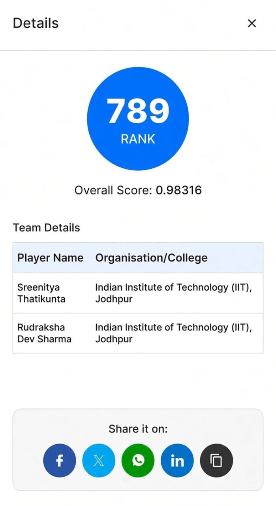
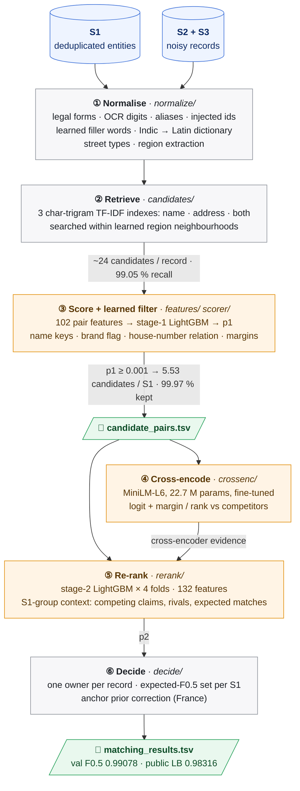

# Business Entity Resolution: Amazon ML Challenge 2026

Our solution to the business entity resolution task of the Amazon ML Challenge 2026, by Sreenitya Thatikunta and Rudraksha Dev Sharma (IIT Jodhpur).

**We finished at rank 789 on the public leaderboard out of more than 25,000 registered teams (top 3.2 %), with a macro F0.5 score of 0.98316.** This placed us in the Top 1,000 teams invited to submit their code and methodology for review.

<p align="center">
  
</p>

## The task

Business records come from three sources. Source 1 (S1) is a deduplicated reference list. Sources 2 and 3 (S2, S3) contain noisy copies of those businesses, mixed with records that match nothing. For every S1 entity, the pipeline has to find all of its S2 and S3 records.

- Names are abbreviated, misspelled, damaged by OCR, aliased or written in Indian scripts, and some are replaced by made-up brand names.
- Addresses are abbreviated, reordered or incomplete, and house numbers are truncated or altered.
- The data contains deliberate lookalikes: unmatched copies of a real entity with one letter changed or the house number shifted by a few units.
- Training covers the US and India. The test set (1.73 M S1, 10 M S2/S3 records) adds France, which has no labels.
- The metric is macro F0.5 per S1 entity, so precision counts twice as much as recall. The organisers also reviewed the size of each team's candidate set, where smaller is better.

## Our approach

The pipeline is a cascade that never compares every record with every entity:

1. **Normalisation**, tuned to the noise we measured in the data: legal forms, OCR digits, aliases, pasted-in ids and phone numbers, learned filler words, a learned Indian-script dictionary, and region extraction from addresses.
2. **Retrieval**: three character-trigram TF-IDF indexes (name, address, both), searched within a learned neighbourhood of the record's region. This finds 99.05 % of the true pairs with about 24 candidates per record.
3. **Scoring and learned blocking**: a LightGBM model on 102 pair features scores every candidate and keeps the pairs with p ≥ 0.001. That leaves **5.53 candidates per S1** while keeping 99.97 % of the retrieved true pairs.
4. **Cross-encoding**: a small transformer (MiniLM, 22.7 M parameters, Apache-2.0), fine-tuned only on pairs the scorer never trained on, reads both records side by side. On its own it is a weaker matcher, but its margin over the competing candidates is a strong signal for the next stage.
5. **Group-aware re-ranking**: a second LightGBM sees every record that competes for the same entity (how many, how strongly, from which source), together with the cross-encoder's margins. It is trained on whole held-out states with complete groups, and size-dependent features are rescaled per country and split, because the test set is denser than the training set.
6. **Decision**: each record gets one owner, and for each entity we keep the set of records with the highest expected F0.5. A label-free correction, estimated from house numbers in the unlabelled test data, handles a French name-change pattern that the training countries don't have.



## Results

| Evaluation | Score |
|---|---|
| Public leaderboard (macro F0.5) | **0.98316** (rank 789) |
| Validation macro F0.5 (222,624 S1 in whole held-out states) | 0.99078 |
| Validation with every state unseen by the model that scores it | 0.98988 |
| Candidate recall in `candidate_pairs.tsv` (validation) | 99.02 % |
| Candidates per S1 (test) | 5.53 |

How the score developed over our submissions:

| Version | Key change | Validation | Public LB |
|---|---|---:|---:|
| v1 | TF-IDF blocking, LightGBM pair scorer, expected-F0.5 decision | 0.98211 | 0.975 |
| v2.1 | stage-2 re-ranker that sees each entity's competing records | 0.98895 | 0.977 |
| v2.2 | per-country, per-split rescaling for the denser test set | 0.98897 | 0.980 |
| v2.4–v2.6 | re-ranker trained on held-out states with complete groups; French prior correction | 0.98918 | 0.982344 |
| **v2.7** | **cross-encoder margins as re-ranker evidence (final)** | **0.99078** | **0.98316** |

## Repository layout

```
.
├── README.md                       this file
├── Documentation_template.md       full methodology write-up, as submitted to the organisers
├── LICENSE
├── assets/
│   └── leaderboard_rank_789.png
└── code/business_entity_resolution/
    ├── README.md                   technical README: architecture, reproduction, configuration
    ├── requirements.txt            pinned dependencies
    └── src/
        ├── ber/                    the pipeline package (python -m ber <stage>)
        ├── tests/                  pytest suite
        └── tools/                  license check, zip builder, cross-encoder prototype scripts
```

## Running it

The challenge data is not included. You need the challenge's `dataset/` folder (with `train/` and `test/`) and, for the final validation step, its `utils/` folder, both placed in the repository root. You also need Python 3.12 or 3.13, an NVIDIA GPU for the cross-encoder and 16 GB of RAM.

```bash
pip install -r code/business_entity_resolution/requirements.txt
export PYTHONPATH="$PWD/code/business_entity_resolution/src"   # Windows: set PYTHONPATH=%CD%\code\business_entity_resolution\src
export PYTHONUTF8=1

for s in split normalize candidates features features-hold scorer crossenc rerank decide submit; do
    python -m ber $s --run main || break
done
```

A full run takes about 11 hours on one laptop (16 threads, 16 GB RAM, RTX 4050 with 6 GB) and writes `output/matching_results.tsv` and `output/candidate_pairs.tsv`. The output files we submitted are not in this repository because of their size (98 MB and 146 MB). The [technical README](code/business_entity_resolution/README.md) has the details.

To run only the test suite, no data is needed: create an empty `dataset/` folder in the repository root (the pipeline uses it to find the project root) and run `python -m pytest code/business_entity_resolution/src/tests`.

## Documentation

- [Technical README](code/business_entity_resolution/README.md): architecture, reproduction and configuration.
- [Methodology write-up](Documentation_template.md): the full report we submitted, with every experiment, ablation and the error analysis.

## License

The code is released under the MIT License (see [LICENSE](LICENSE)). The cross-encoder checkpoint (`cross-encoder/ms-marco-MiniLM-L-6-v2`) is Apache-2.0. All dependencies are MIT, BSD, Apache-2.0 or PSF licensed, except two MPL-2.0 packages (`tqdm`, `certifi`) that are used unmodified. The challenge data is not included.
