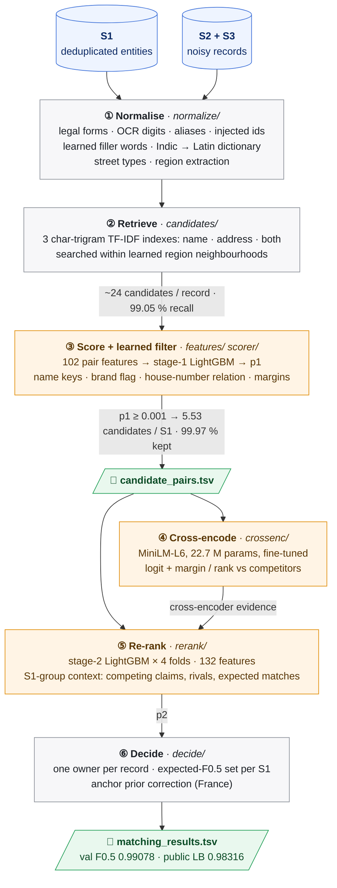
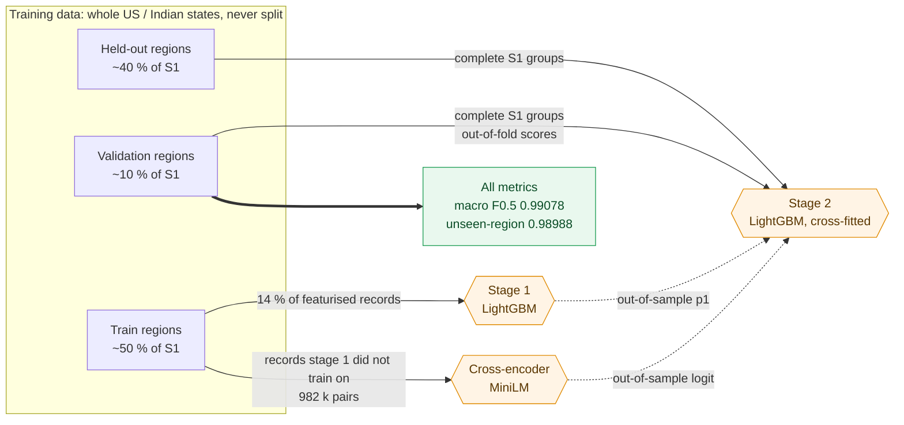

# Business Entity Resolution (Amazon ML Challenge 2026)

This is our pipeline for matching messy business records to the entities they describe.
- **The data.** There's a clean, deduplicated reference list (S1) and two noisy secondary sources (S2, S3). It covers the US and India, plus France, which only shows up in the test set.
- **How it works.** Character-trigram retrieval and a learned filter narrow the search to about 5.5 candidates per entity, while keeping 99 % of the true matches. A LightGBM re-ranker that knows about competing records makes the final call, helped by a fine-tuned transformer cross-encoder.
- **How well it does.** Macro F0.5 of **0.99078** on held-out states, and **0.98316** on the public leaderboard.

| Metric | Value |
|---|---|
| Validation macro F0.5 (222,624 S1 entities in whole held-out states) | **0.99078** |
| Public leaderboard F0.5 | **0.98316** |
| Candidate recall (true pairs kept in `candidate_pairs.tsv`, validation) | **99.02 %**, with 5.53 candidates per S1 on test |
| End-to-end runtime | ≈ 11 h with a single CUDA GPU |



## The problem

S1 is a deduplicated list of businesses. S2 and S3 each hold their own noisy copies of those businesses, mixed in with records that don't match anything. For every S1 entity, we have to list its S2 and S3 records.

What makes it hard:
- **Names get mangled.** There are abbreviations, legal forms, typos, OCR errors, aliases, trade names, and names written in Indian scripts.
- **Addresses get mangled too.** Abbreviations, missing or reordered parts, and changed house numbers.
- **Some records are deliberate traps.** Lookalikes have the same name and street as a real entity but a house number a few units off.
- **Precision matters most.** The metric is macro F0.5 per S1 entity, which weighs precision twice as much as recall. An entity with no matches has to be predicted empty.
- **The test set is different.** Training covers the US and India. The test set (1.73 M S1, 10 M S2/S3 records) adds France, and there are no labels for it.

## Our approach

- **Clean the text with the noise in mind.**
  - Rules handle legal forms, OCR digits, aliases, and ids and phone numbers pasted into names.
  - Filler words are learned from the data.
  - Indian-script names are romanised with a dictionary learned from training pairs.
  - Regions (states, state codes, French départements) are pulled out of addresses.
- **Keep the candidate set small without losing matches.**
  - Three character-trigram TF-IDF indexes (name, address, both) are searched near the record's region. Together they find 99.05 % of true pairs.
  - A LightGBM scorer on 102 pair features then acts as the final blocking filter. 5.53 candidates per S1 are left, and 99.97 % of the true pairs we retrieved survive.
- **Use the transformer where it's good.**
  - A 22.7 M-parameter MiniLM cross-encoder reads both records together. We fine-tune it only on pairs the scorer never trained on.
  - As a matcher on its own it's weaker (AUC 0.975 against 0.999). But how far ahead it rates a pair against the competing candidates turns out to be a strong hint for the re-ranker.
- **Re-rank with the competition in view.**
  - A second LightGBM sees who else is competing for each S1 entity: how many records claim it, how strongly, and from which source. It also gets the cross-encoder's margins.
  - It trains on whole held-out states where every entity's records are all present, just like at test time.
  - Features that depend on how crowded the data is get rescaled per country and split, because the test set is denser than training.
- **Make the final call.**
  - Each record gets one owner. Then, for each S1, we keep the set of records with the highest expected F0.5.
  - France has a kind of name change the US and India don't. A correction estimated from house numbers in the unlabelled test data handles it.

## Results

| Evaluation | Macro F0.5 |
|---|---|
| Validation: 222,624 S1 in whole held-out states | **0.99078** |
| US / India | 0.99147 / 0.98970 |
| S1 entities without a true match | 0.99343 |
| Validation with every state unseen by the model scoring it | 0.98988 |
| Public leaderboard | **0.98316** |

Pair precision on validation is 0.99898 and pair recall is 0.97408. For ablations, error analysis and the reasoning behind each design decision, see `Documentation_template.md` at the root of the submission package.

### How we got here

| Version | Key idea | Validation | Public LB |
|---|---|---:|---:|
| v1 | TF-IDF blocking, LightGBM pair scorer, expected-F0.5 decision | 0.98211 | 0.975 |
| v2.1 | stage-2 re-ranker that sees each S1's competing records | 0.98895 | 0.977 |
| v2.2 | per-country, per-split rescaling (the test set is denser) | 0.98897 | 0.980 |
| v2.4–v2.6 | re-ranker trained on held-out states with complete S1 groups; French prior correction | 0.98918 | 0.982344 |
| **v2.7** | **+ MiniLM cross-encoder margins as re-ranker evidence** | **0.99078** | **0.98316** |

We also tried several other ideas in separate branches. They're written up with their numbers in `Documentation_template.md`, Appendix C:
- Rudraksha's inverted-index baseline;
- a separate model for unseen countries, trained on synthetic French data;
- test-shaped validation, and rehearsing France by leaving one country out;
- pseudo-labelling;
- an LLM that picks among the top candidates (designed, but never trained).

The code for the ideas we dropped isn't in this package.

## Architecture

Every model is scored on data it never trained on. We split by whole US and Indian states, so lookalikes end up on the same side as the entities they copy.



| Step | Stages | Code | What it does |
|---|---|---|---|
| Normalize | `split`, `normalize` | `eval/split.py`, `normalize/` | Splits train/validation by whole states; cleans names, legal forms, addresses and regions |
| Retrieve | `candidates` | `candidates/` | Region-blocked character-trigram TF-IDF, top 10 per index |
| Score | `features`, `features-hold`, `scorer` | `features/`, `scorer/` | 102 pair features and the LightGBM scorer; pairs with p ≥ 0.001 make up `candidate_pairs.tsv` |
| Cross-encode | `crossenc` | `crossenc/` | Fine-tunes the MiniLM cross-encoder and scores every candidate pair |
| Re-rank | `rerank` | `rerank/` | Cross-fitted LightGBM with S1-group context and the cross-encoder's margins |
| Assign | `decide`, `submit` | `decide/`, `submit.py` | One owner per record, expected F0.5 per S1, prior correction; writes `output/` and runs the official validator |

A few things about how the stages fit together:
- You run each stage as `python -m ber <stage> --run <run>`.
- Each stage reads the previous one's output from `artifacts/<run>/<stage>/` and writes its own there.
- Every stage also writes a `manifest.json` with the config hash, git commit, timings, peak memory and metrics.
- All parameters live in [`src/ber/configs/default.yaml`](src/ber/configs/default.yaml), which is our submitted configuration.

## Reproducing the results

### Quick start

You'll need:
- Python 3.12 or 3.13 (the pinned numpy and scipy need at least 3.12);
- a CUDA-capable GPU for the cross-encoder (the CPU build works, just slowly);
- to run from the directory that contains `dataset/` (with `train/` and `test/`) and this `code/` folder.

```bash
python -m venv .venv && source .venv/bin/activate   # Windows: .venv\Scripts\activate
pip install -r code/business_entity_resolution/requirements.txt
export PYTHONPATH="$PWD/code/business_entity_resolution/src"   # Windows: set PYTHONPATH=%CD%\code\business_entity_resolution\src
export PYTHONUTF8=1

for s in split normalize candidates features features-hold scorer crossenc rerank decide submit; do
    python -m ber $s --run main || break
done
```

This writes `output/matching_results.tsv` and `output/candidate_pairs.tsv`, and checks both with the official validator.

Two handy commands:
- `python -m pytest code/business_entity_resolution/src/tests` checks that everything installed correctly.
- `python -m ber explain <entity_id> --run main` follows one record through every stage.

A few notes:
- Run the stages one at a time, since several of them need 8–10 GB of RAM.
- The cross-encoder behind the submitted file was trained with the scripts in [`src/tools/crossenc_prototype/`](src/tools/crossenc_prototype/README.md). They follow the same procedure as the `crossenc` stage.
- GPU training isn't bit-for-bit deterministic, so a re-run gives a very close file, but not an identical one.
- Runtime and memory per stage, how to run the training and test sides separately, and the main settings are all in `Documentation_template.md`, Appendix D.

## Repository structure

```
code/business_entity_resolution/
├── README.md
├── requirements.txt              every dependency, pinned
└── src/
    ├── ber/                      the pipeline package (python -m ber <stage>)
    │   ├── cli.py, config.py, artifacts.py, io.py, log.py, explain.py, submit.py
    │   ├── configs/              default.yaml (the submitted configuration), dev.yaml
    │   ├── eval/                 geographic split, macro F0.5
    │   ├── normalize/            names, addresses, regions, transliteration, lookup tables
    │   ├── candidates/           TF-IDF retrieval (CPU or GPU)
    │   ├── features/             pair features
    │   ├── scorer/               LightGBM scorer and learned filter
    │   ├── crossenc/             transformer cross-encoder
    │   ├── rerank/               group-aware re-ranker
    │   └── decide/               one owner per record, expected F0.5, prior correction
    ├── tests/                    pytest suite
    └── tools/
        ├── check_licenses.py     dependency license audit
        ├── make_submission_zip.py  builds the submission zip
        └── crossenc_prototype/   the scripts that trained the submitted cross-encoder
```

## Team and license

- Team: Sreenitya Thatikunta and Rudraksha Dev Sharma.
- Our code is under the MIT License.
- Every dependency is MIT, BSD, Apache-2.0 or PSF, which `src/tools/check_licenses.py` checks. Two MPL-2.0 packages, `tqdm` and `certifi`, are used unmodified.
- The model is `cross-encoder/ms-marco-MiniLM-L-6-v2` (Apache-2.0, 22.7 M parameters). The challenge allows MIT or Apache-2.0 models up to 8 B parameters.
- We only used the challenge's training and test files: no external data, lookups or APIs. The only outside artefact is the pretrained cross-encoder checkpoint.
